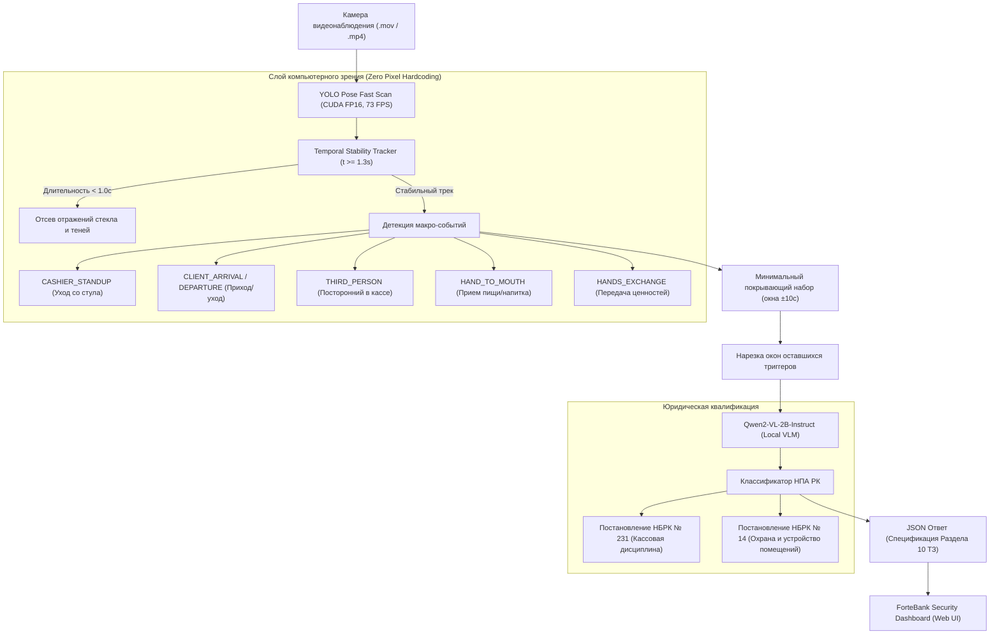

# ForteBank Cash Desk AI Security & Compliance Guard
### Datathon 26 — Система интеллектуального видеомониторинга кассовой дисциплины

[](https://fastapi.tiangolo.com)
[](https://docs.ultralytics.com)
[](https://huggingface.co/Qwen/Qwen2-VL-2B-Instruct)
[](https://developer.nvidia.com/cuda-toolkit)
[](LICENSE)

Автономный сервис видеоаналитики для выявления нарушений регламента и кассовой дисциплины в отделениях **ForteBank** на базе двухэтапной гибридной архитектуры: высокоскоростного трекера макро-событий **YOLO Pose** (73+ FPS) и локальной мультимодальной модели **Qwen2-VL-2B-Instruct**.

---

## 🌟 Ключевые особенности и преимущества

1. **Двухэтапная гибридная архитектура (Event-Driven Vision):**
   - Вместо затратной покадровой подачи всего видеопотока в VLM, быстрый модуль **YOLO Pose** непрерывно сканирует поток со скоростью **73+ FPS** на GPU в FP16, извлекая только переходные события (уход со стула, вход/выход клиента, передача денег, рука у лица).
   - **Минимальный покрывающий набор триггеров:** из всех событий оставляется минимальное подмножество, окна ±10 с которого покрывают ту же часть видео, что и все события вместе (жадное покрытие интервалами). Подавленные события сливаются в ближайший оставшийся триггер вместе со своими промптами, поэтому recall при допуске 10 с не падает по построению, а число вызовов VLM сокращается в 2.4 раза.
   - Локальная VLM инспектирует только окна вокруг оставшихся триггеров (6–10 кадров) с объединенным контекстным промптом под типы событий.

2. **Temporal Stability Tracker (подавление отражений без хардкода координат):**
   - **Zero Pixel Hardcoding:** Нет статичных прямоугольников кассы или полигонов стула. Положение кассира за столом вычисляется динамически из первых стабильных кадров видеопотока.
   - **Фильтрация отражений в стекле:** Блики, отражения и тени из стеклянной двери мерцают и исчезают быстрее $1.0$ с. Трекер учитывает человека только при непрерывном удержании $\ge 1.3$ с ($\ge 8$ кадров), полностью исключая ложные срабатывания.

3. **Автоматическая квалификация по законам Республики Казахстан:**
   - Каждое зафиксированное нарушение связывается с нормативно-правовыми актами Национального Банка РК (adilet.zan.kz):
     - **Постановление Правления НБРК от 29.11.2019 № 231** (Правила осуществления кассовых операций и операций по инкассации).
     - **Постановление Правления НБРК от 24.02.2020 № 14** (Правила организации охраны и устройства помещений банков).

4. **Полное соответствие API ТЗ (Раздел 10):**
   - Асинхронные эндпоинты `POST /api/v1/analyze` (возврат `job_id`) и `GET /api/v1/jobs/{job_id}` (статус и список нарушений с кадрами-доказательствами в Base64).
   - Авторизация через заголовок `X-API-Key: forte-secret-key-2026`.

5. **Премиальный веб-интерфейс ForteBank:**
   - Фирменная дизайн-система в палитре ForteBank (`#9c1c54`), таймлайн с интерактивными пинами нарушений, карточки доказательств и модальное окно просмотра доказательных кадров.

---

## 📊 Результаты бенчмарка (все 42 видео датасета)

Аудит проведен на всей контрольной выборке датасета из **42 видеозаписей** (22 с нарушениями, 20 без нарушений):

| Показатель | Значение |
| :--- | :--- |
| **Recall (Полнота детекции нарушений)** | **100.0% (22 из 22 нарушений поймано)** |
| **Среднее отклонение таймкода ($\Delta t$)** | **3.70 секунды** от эталонной разметки (макс. 8.5 с при допуске 10 с) |
| **Среднее количество триггеров на видео** | **2.6 триггера** (109 на 42 видео; до отбора покрывающего набора — 6.2, т.е. 259) |
| **Скорость инференса на GPU (RTX 3060 Laptop)** | **73.1 FPS** (8 661 кадров за 118.4 с) |
| **Ложные срабатывания от отражений стеклянной двери** | **0 (полностью подавлены temporal-трекером)** |

Полная детализация аудита по каждому видео сохранена в файле [`all_42_temporal_audit.csv`](all_42_temporal_audit.csv).

---

## 🏗 Архитектура пайплайна



---

## 📁 Структура проекта

```text
forte-cashdesk-ai/
├── main.py                             # FastAPI сервер с маршрутами /api/v1/analyze и /api/v1/jobs
├── detector.py                         # Интеграционный пайплайн: CV триггеры + VLM валидация
├── cv_triggers.py                      # YOLO Pose Temporal Stability Tracker (без хардкода пикселей)
├── legal_base.py                       # База нормативно-правовых актов НБРК (№ 231, № 14)
├── index.html                          # Интерактивный веб-дашборд в брендинге ForteBank
├── verify_temporal_triggers.py         # Скрипт полного батч-аудита на GPU по всем 42 видео
├── all_42_temporal_audit.csv           # Итоговая ведомость аудита (100% recall, 2.6 триггера/видео, 3.70с delta)
├── open_labels_with_descriptions.xlsx  # Разметка датасета с юридическими формулировками
├── open_labels_copy.csv                # Текстовая версия разметки для быстрого парсинга
├── requirements.txt                    # Список зависимостей Python
└── .gitignore                          # Исключение медиафайлов, весов и кэша
```

---

## 🚀 Быстрый старт

### 1. Клонирование репозитория
```bash
git clone https://github.com/yerarassyl/fortebank-cashdesk-ai.git
cd fortebank-cashdesk-ai
```

### 2. Установка зависимостей
Рекомендуется использовать виртуальное окружение с Python 3.10+ и установленным PyTorch с поддержкой CUDA:
```bash
python -m venv venv
# Активация на Windows:
venv\Scripts\activate
# Активация на Linux/macOS:
source venv/bin/activate

pip install -r requirements.txt
```

### 3. Запуск сервиса
```bash
python main.py
```
Сервер запустится на `http://0.0.0.0:8000`.

- **Веб-интерфейс:** откройте `http://localhost:8000` в браузере.
- **Интерактивная документация Swagger:** `http://localhost:8000/docs`.

---

## 📡 Примеры использования API (Раздел 10 ТЗ)

### 1. Отправка видео на анализ
```bash
curl -X POST "http://localhost:8000/api/v1/analyze" \
     -H "X-API-Key: forte-secret-key-2026" \
     -F "file=@videos/Х-20.mov"
```
**Ответ:**
```json
{
  "job_id": "a1b2c3d4"
}
```

### 2. Получение результата проверки
```bash
curl -X GET "http://localhost:8000/api/v1/jobs/a1b2c3d4" \
     -H "X-API-Key: forte-secret-key-2026"
```
**Ответ при выявлении нарушения:**
```json
{
  "job_id": "a1b2c3d4",
  "status": "done",
  "verdict": "violation",
  "violations": [
    {
      "type": "Ценности оставлены на рабочем месте / кассир покинул место во время обслуживания",
      "timecode_sec": 7.5,
      "description": "Кассир встала и отошла от стола, на столе остались пачки купюр, дверца сейфа открыта. Норматив: Постановление Правления НБРК от 29.11.2019 № 231, п. 20, п. 22 (adilet.zan.kz/rus/docs/V1900019680). «Все ранее принятые наличные деньги хранятся в специальных устройствах, находящихся на рабочем месте кассового работника, закрывающихся на ключ, предназначенных для хранения наличных денег (металлический шкаф, сейф, тележка, ящики стола, тумба). … Кассовому работнику не допускается покидать рабочее место до окончания обслуживания клиента.»",
      "evidence_frames": [
        {
          "timestamp_sec": 7.5,
          "image_base64": "/9j/4AAQSkZJRgABAQAAAQABAAD..."
        }
      ]
    }
  ]
}
```

---

## ⚖️ Нормативно-правовая база

Система опирается на актуальные требования законодательства РК для банков второго уровня:
- [Постановление Правления Национального Банка РК от 29 ноября 2019 года № 231](https://adilet.zan.kz/rus/docs/V1900019680) (зарегистрировано в МЮ РК 3 декабря 2019 года № 19680) — Об утверждении Правил осуществления кассовых операций и операций по инкассации банкнот, монет и ценностей в банках второго уровня, филиалах банков-нерезидентов Республики Казахстан, Национальном операторе почты и юридических лицах, исключительной деятельностью которых является инкассация банкнот, монет и ценностей.
- [Постановление Правления Национального Банка РК от 24 февраля 2020 года № 14](https://adilet.zan.kz/rus/docs/V2000020075) — Об утверждении Правил организации охраны и устройства помещений банков второго уровня, филиалов банков-нерезидентов Республики Казахстан, Национального оператора почты, юридических лиц, исключительной деятельностью которых является инкассация банкнот, монет и ценностей.

---

## 👥 Авторы
Разработано в рамках Datathon 26 для ForteBank.
Автор: [@yerarassyl](https://github.com/yerarassyl)
